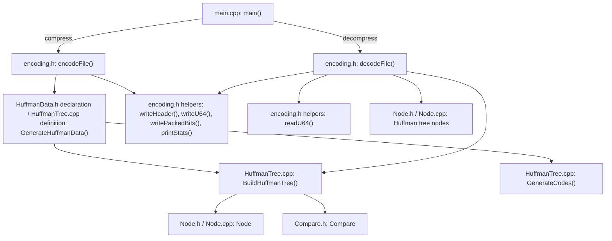

# Huffman File Compression Utility (C++)

A small command-line utility that compresses and decompresses files using Huffman coding. It uses a frequency table, a min-heap, a binary Huffman tree, and binary file I/O.

## Features

- Compresses files using Huffman coding.
- Decompresses files created by this utility.
- Reads files in binary mode, so all byte values (0–255) are supported.
- Stores the original file size and the byte-frequency table needed to rebuild the Huffman tree.
- Packs Huffman codes into bytes.
- Handles empty files and files containing only one distinct byte.
- Uses raw storage when Huffman coding plus its metadata would make the output larger.
- Displays the original size, output size, and percentage space change.
- Reports basic input, output, and invalid-file errors.

## Project files

| File | Purpose |
|---|---|
| `main.cpp` | Reads command-line arguments, selects compression or decompression, and handles exceptions. |
| `Node.h`, `Node.cpp` | Declare and define the `Node` structure used by the Huffman tree. |
| `Compare.h` | Defines the comparator used by the priority queue to behave as a min-heap. |
| `HuffmanTree.h`, `HuffmanTree.cpp` | Declare and implement Huffman tree construction, code generation, tree deletion, and input frequency analysis. |
| `HuffmanData.h` | Defines the `HuffmanData` structure and declares `GenerateHuffmanData()`. |
| `encoding.h` | Implements the compressed-file format, bit packing, compression, decompression, and statistics. |

## Build

A C++11-compatible compiler is required.

Compile from the project directory:

```bash
g++ -std=c++11 main.cpp Node.cpp HuffmanTree.cpp -o compressor
```

On Windows, this creates `compressor.exe`.

## Run

### Compress a file

```bash
./compressor c input.txt
```

The default output name is `input.txt.huf`.

To choose the output name:

```bash
./compressor c input.txt archive.huf
```

### Decompress a file

```bash
./compressor d archive.huf
```

The default output name is `archive.huf.out`.

To choose the restored file name:

```bash
./compressor d archive.huf restored.txt
```

On Windows PowerShell, use `./compressor.exe` or ` .\compressor.exe` in place of `./compressor`.

## How the program works

### Compression flow

1. `main()` reads the command and calls `encodeFile()`.
2. `GenerateHuffmanData()` reads the input in binary mode and counts the frequency of each byte.
3. `BuildHuffmanTree()` builds a Huffman tree from the frequency table using a min-heap.
4. `GenerateCodes()` creates a binary code for each byte.
5. The encoder estimates the Huffman output size, including the header and frequency table.
6. If Huffman output would not be smaller, the file is stored in raw mode. Otherwise, the frequency table and packed Huffman bitstream are written.
7. The program prints the resulting file size and space change.

### Decompression flow

1. `main()` reads the command and calls `decodeFile()`.
2. The decoder checks the `HUF1` signature, reads the storage mode and original size.
3. In raw mode, it copies the stored original bytes.
4. In Huffman mode, it reads the frequency table and rebuilds the Huffman tree.
5. It reads the packed bits and traverses the tree to reconstruct the original bytes. The original size determines when decoding stops.
6. The program closes the output and reports the restored size.

## Function reference

This table lists the functions implemented by the project and where their declarations and definitions are located.

| Function | Declared in | Defined in | Purpose |
|---|---|---|---|
| `Node(unsigned char, std::uint64_t)` | `Node.h` | `Node.cpp` | Initializes a node's byte value, frequency, and null child pointers. |
| `Compare::operator()(const Node*, const Node*)` | `Compare.h` | `Compare.h` | Compares node frequencies so the priority queue places the lowest frequency at the top. |
| `BuildHuffmanTree(const std::uint64_t[256])` | `HuffmanTree.h` | `HuffmanTree.cpp` | Creates leaf nodes from non-zero frequencies and combines the two lowest-frequency nodes until one root remains. |
| `GenerateCodes(Node*, const std::string&, std::string[256])` | `HuffmanTree.h` | `HuffmanTree.cpp` | Traverses the tree and stores a binary code for each leaf byte. |
| `DeleteTree(Node*)` | `HuffmanTree.h` | `HuffmanTree.cpp` | Recursively releases the dynamically allocated tree nodes. |
| `GenerateHuffmanData(const std::string&)` | `HuffmanData.h` | `HuffmanTree.cpp` | Reads the input file, counts byte frequencies, builds the tree, and generates the code table. |
| `writeU64(std::ostream&, std::uint64_t)` | `encoding.h` | `encoding.h` | Writes a 64-bit integer in little-endian byte order. |
| `readU64(std::istream&)` | `encoding.h` | `encoding.h` | Reads a 64-bit little-endian integer and reports truncated input. |
| `writeHeader(std::ostream&, unsigned char, std::uint64_t)` | `encoding.h` | `encoding.h` | Writes the signature, storage mode, and original file size. |
| `writePackedBits(std::istream&, std::ostream&, const std::string[256])` | `encoding.h` | `encoding.h` | Converts the generated bit codes into bytes and writes the packed bitstream. |
| `printStats(std::uint64_t, std::uint64_t)` | `encoding.h` | `encoding.h` | Displays original size, compressed size, and percentage space change. |
| `encodeFile(const std::string&, const std::string&)` | `encoding.h` | `encoding.h` | Coordinates frequency analysis, size comparison, raw/Huffman storage, file writing, and compression statistics. |
| `decodeFile(const std::string&, const std::string&)` | `encoding.h` | `encoding.h` | Reads the archive and restores the original bytes using raw copying or Huffman tree traversal. |
| `main(int, char*[])` | `main.cpp` | `main.cpp` | Parses the command-line mode and file paths, invokes compression/decompression, and catches exceptions. |

The small helper functions `writeU64`, `readU64`, `writeHeader`, `writePackedBits`, and `printStats` are inside the `huffman_detail` namespace in `encoding.h`.

## Function and file dependency flow

The following diagram shows the main call flow and which project files provide each part.



## Compressed file format

The utility writes a simple binary format. Integer fields are stored in little-endian order.

| Field | Size | Description |
|---|---:|---|
| Signature | 4 bytes | The characters `HUF1`. |
| Mode | 1 byte | `0` for Huffman mode, `1` for raw mode. |
| Original size | 8 bytes | Number of bytes in the original file. |
| Frequency table | 2,048 bytes | Present only in Huffman mode: 256 unsigned 64-bit byte frequencies. |
| Data | Variable | Packed Huffman bits in Huffman mode, or original file bytes in raw mode. |

The decoder uses the original size to know when the output is complete, so unused padding bits at the end of the final encoded byte are ignored.

## Testing the restored file

After decompressing, compare the original file with the restored file.

Windows PowerShell:

```powershell
cmd /c "fc /b input.txt restored.txt"
```

Linux/macOS:

```bash
cmp input.txt restored.txt
```

If the files match, the comparison reports no differences (or `cmp` exits without printing a difference).

## Current scope

This project focuses on the basic Huffman compression/decompression workflow, archive metadata, reconstruction verification, compression statistics, empty-file and single-byte-file handling, and basic error handling. It is a learning project, not a production-grade archiver.
