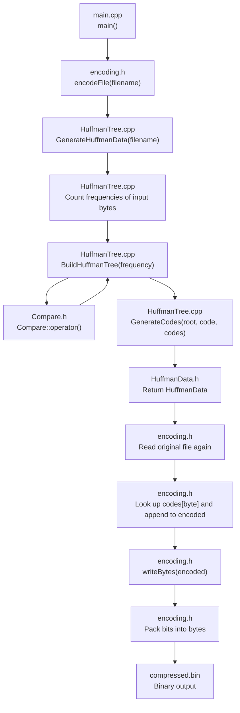

# File Compression Utility — C++

A console-based file compression utility built in **C++** using the **Huffman Coding algorithm**. This project is being developed as a hands-on exercise in data structures, algorithms, bit manipulation, and binary file handling.

> **Current Status:** Huffman tree construction, code generation, and the initial binary encoding pipeline are implemented. The program can encode an input file into packed bytes and write them to `compressed.bin`. Storing decoding metadata and implementing decompression are the next major steps.

---

## Table of Contents

- [About the Project](#about-the-project)
- [What is Huffman Coding?](#what-is-huffman-coding)
- [Current Implementation](#current-implementation)
- [Project Structure](#project-structure)
- [Function Reference](#function-reference)
- [Overall Program Flow](#overall-program-flow)
- [Understanding the Encoding Process](#understanding-the-encoding-process)
- [How to Compile and Run](#how-to-compile-and-run)
- [Development Roadmap](#development-roadmap)
- [Learning Objectives](#learning-objectives)

---

## About the Project

The goal of this project is to build a file compression utility from scratch using C++ and Huffman Coding.

Huffman Coding is a lossless compression algorithm that assigns variable-length binary codes to characters or byte values based on their frequency of occurrence.

- Frequently occurring bytes generally receive shorter codes.
- Less frequently occurring bytes generally receive longer codes.

This allows data to be represented using fewer bits than its original representation.

The project is being developed incrementally, with each stage focusing on understanding and implementing a specific part of the compression process.

## What is Huffman Coding?

Huffman Coding is a greedy algorithm used for lossless data compression.

Unlike fixed-length encoding, where every character receives the same number of bits, Huffman Coding uses variable-length codes.

### Important properties

- **Lossless compression:** The original data can be reconstructed exactly.
- **Variable-length encoding:** Different byte values receive codes of different lengths.
- **Prefix-free codes:** No character's code is a prefix of another character's code.
- **Greedy construction:** At each step, the two nodes with the lowest frequencies are combined.

---

## Current Implementation

The following components have been implemented.

### Completed features

- [x] Read an input file in binary mode.
- [x] Calculate the frequency of all 256 possible byte values.
- [x] Implement a custom `Node` structure for the Huffman Tree.
- [x] Implement a custom comparator for the priority queue.
- [x] Construct a Huffman Tree using a min-heap.
- [x] Handle empty input and single-byte-type input during tree construction and code generation.
- [x] Generate Huffman codes through recursive tree traversal.
- [x] Store generated codes in an array of 256 strings.
- [x] Read the original file again and encode its bytes in their original order.
- [x] Convert Huffman bit strings into packed binary bytes.
- [x] Write complete bytes to a binary output file.
- [x] Handle the final incomplete byte by padding it with zeroes.
- [x] Generate `compressed.bin` as the binary output.

### Still under development

- [ ] Store the original file size in the compressed file.
- [ ] Store the Huffman Tree information or equivalent decoding metadata.
- [ ] Implement decompression.
- [ ] Verify that decompressed output matches the original file byte-for-byte.
- [ ] Display compression statistics.
- [ ] Improve error handling and edge-case handling.

**Initial test result:** A 15-byte input file produced a 6-byte binary output. This is an initial encoding result; complete validation requires implementing metadata storage and decompression.

---

## Project Structure

The project follows a modular C++ structure, separating declarations, definitions, and responsibilities across multiple files.

```text
File Compression Utility/
│
├── main.cpp
│
├── Node.h
├── Node.cpp
│
├── Compare.h
│
├── HuffmanTree.h
├── HuffmanTree.cpp
│
├── HuffmanData.h
├── encoding.h
│
├── .gitignore
└── README.md
```

### File responsibilities

| File | Responsibility |
|---|---|
| `main.cpp` | Program entry point; starts the encoding process. |
| `Node.h` | Declares the Huffman Tree node structure. |
| `Node.cpp` | Defines the Node constructor. |
| `Compare.h` | Defines the custom priority queue comparator. |
| `HuffmanTree.h` | Declares Huffman Tree construction and code generation functions. |
| `HuffmanTree.cpp` | Defines tree construction, code generation, and frequency analysis. |
| `HuffmanData.h` | Defines the `HuffmanData` structure and declares `GenerateHuffmanData()`. |
| `encoding.h` | Defines the functions responsible for encoding the original file and writing packed binary bytes. |

---

## Function Reference

This section explains what each function does, where it is defined, and how it contributes to the overall program.

### 1. `Node::Node()` — `Node.cpp`

The constructor for the Huffman Tree node.

Responsibilities:

- Stores the byte value.
- Stores its frequency.
- Initializes the left and right child pointers to `nullptr`.

Every node in the Huffman Tree is created using this constructor.

### 2. `Compare::operator()()` — `Compare.h`

The custom comparator used by the priority queue.

It compares two `Node*` values using their frequencies.

The comparison is designed so that the node with the lowest frequency appears at the top of the priority queue.

This allows us to efficiently retrieve the two least frequent nodes during Huffman Tree construction.

### 3. `BuildHuffmanTree()` — `HuffmanTree.h` / `HuffmanTree.cpp`

**Declaration:** `HuffmanTree.h`

**Definition:** `HuffmanTree.cpp`

```cpp
Node* BuildHuffmanTree(const int frequency[256]);
```

This function constructs the Huffman Tree using the frequency array.

Its working:

1. Creates a priority queue of `Node*` using the custom `Compare` comparator.
2. Iterates through the frequency array.
3. Creates a leaf node for every byte whose frequency is greater than zero.
4. Removes the two nodes with the lowest frequencies.
5. Creates a new internal node whose frequency is the sum of those two nodes.
6. Assigns the extracted nodes as its left and right children.
7. Inserts the new node back into the priority queue.
8. Repeats until only one node remains.

The remaining node becomes the root of the Huffman Tree.

If the frequency array contains no characters, the function returns `nullptr`.

### 4. `GenerateCodes()` — `HuffmanTree.h` / `HuffmanTree.cpp`

**Declaration:** `HuffmanTree.h`

**Definition:** `HuffmanTree.cpp`

```cpp
void GenerateCodes(Node* root, string code, string codes[256]);
```

This function generates Huffman codes by recursively traversing the tree.

Its working:

- Moving to the left child appends `0` to the current code.
- Moving to the right child appends `1` to the current code.
- When a leaf node is reached, the accumulated code is stored in the corresponding position of the code array.

The generated codes are stored using the byte value as the array index.

For example:

```cpp
codes[root->character] = code;
```

A special case is handled when the tree contains only one leaf node. In that situation, the code `"0"` is assigned instead of leaving the code empty.

### 5. `GenerateHuffmanData()` — `HuffmanData.h` / `HuffmanTree.cpp`

**Declaration:** `HuffmanData.h`

**Definition:** `HuffmanTree.cpp`

```cpp
HuffmanData GenerateHuffmanData(const string& filename);
```

This function coordinates the initial Huffman preparation process.

Its working:

1. Opens the input file in binary mode.
2. Reads the file byte by byte.
3. Counts the frequency of every possible byte value using an array of 256 integers.
4. Calls `BuildHuffmanTree()` to construct the Huffman Tree.
5. Calls `GenerateCodes()` to generate the Huffman codes.
6. Stores the root pointer and generated codes inside a `HuffmanData` object.
7. Returns the completed object.

The returned `HuffmanData` contains:

- `root`: Pointer to the root of the Huffman Tree.
- `codes[256]`: Array containing the generated Huffman codes.

This function performs the first read of the input file. Its purpose is frequency analysis and code generation.

### 6. `encodeFile()` — `encoding.h`

```cpp
void encodeFile(const string& filename);
```

This function coordinates the actual encoding process.

Its working:

1. Calls `GenerateHuffmanData(filename)` to obtain the Huffman Tree and code table.
2. Opens the original file again in binary mode.
3. Reads the original file one byte at a time.
4. Converts each read character into `unsigned char`.
5. Uses that byte value to look up its corresponding Huffman code in `data.codes[256]`.
6. Appends the code to the `encoded` string.
7. Once the entire file has been processed, calls `writeBytes(encoded)`.

**Why does it read the original file again?**

The first pass is used for frequency counting and Huffman code generation.

The second pass performs the actual encoding.

Reading the original file in its original sequence ensures that the encoded output preserves the original byte order.

The code array acts only as a lookup table. It does not determine the order of encoding.

### 7. `writeBytes()` — `encoding.h`

```cpp
void writeBytes(const string& codes);
```

This function converts the encoded bit string into actual binary bytes and writes them to `compressed.bin`.

Its working:

1. Opens `compressed.bin` in binary output mode.
2. Creates an empty byte buffer:

```cpp
unsigned char byte = 0;
```

3. Reads the encoded string one bit-character at a time.
4. Converts each character from `'0'` or `'1'` into numeric `0` or `1`:

```cpp
int bit = codes[i] - '0';
```

5. Shifts the current byte left by one position and inserts the incoming bit:

```cpp
byte = (byte << 1) | bit;
```

6. Once 8 bits have been collected, writes the byte using:

```cpp
outputFile.put(byte);
```

7. Resets the byte buffer and bit counter.
8. After the loop, checks whether any bits remain.
9. If the final byte contains fewer than 8 meaningful bits, shifts those bits towards the left and pads the remaining positions with zeroes.
10. Writes the final byte and closes the output file.

This allows multiple Huffman bits to be stored inside a single byte rather than storing every bit as a separate text character.

The final byte may contain padding zeroes. The current compressed file does not yet store the information required to distinguish those padding bits during decompression. That will be addressed through the file metadata.

---

## Overall Program Flow

This is the overall execution flow of the current implementation.

The diagram uses the function names and their respective files so that it is easier to understand which function calls which other function.



### Understanding the flow step by step

**Step 1 — Program entry**

Execution begins inside `main()` in `main.cpp`.

It calls:

```cpp
encodeFile("123.txt");
```

**Step 2 — Huffman preparation**

`encodeFile()` calls:

```cpp
GenerateHuffmanData(filename);
```

This function performs frequency counting, tree construction, and code generation.

**Step 3 — Tree construction**

`GenerateHuffmanData()` calls:

```cpp
BuildHuffmanTree(frequency);
```

The priority queue uses the custom comparator defined in `Compare.h`.

**Step 4 — Code generation**

After the tree is constructed, `GenerateHuffmanData()` calls:

```cpp
GenerateCodes(root, "", codes);
```

The generated code table is stored inside the returned `HuffmanData` object.

**Step 5 — Actual encoding**

`encodeFile()` reads the original file again.

For every byte, it looks up the corresponding Huffman code and appends it to the encoded string.

**Step 6 — Binary writing**

After the complete encoded bit string has been generated, `encodeFile()` calls:

```cpp
writeBytes(encoded);
```

**Step 7 — Final output**

`writeBytes()` packs the bits into bytes and writes them into:

```text
compressed.bin
```

---

## Understanding the Encoding Process

A Huffman code is currently represented as a string containing characters such as:

```text
"010110"
```

However, storing these characters directly would mean storing text rather than packed binary data.

Instead, the encoder packs multiple bits into a single byte.

For example:

```text
Encoded bits: 101
```

The byte buffer initially contains:

```text
00000000
```

After inserting the three bits:

```text
00000101
```

The remaining five positions are padding.

The encoder shifts the meaningful bits towards the left before writing the final incomplete byte:

```text
10100000
```

This is why the program uses:

```cpp
byte = byte << (8 - iteration);
```

The output file uses the `.bin` extension because it contains binary data rather than human-readable text.

---

## How to Compile and Run

Make sure you have a C++ compiler such as GCC installed.

### 1. Compile the project

Run this command from the project directory:

```bash
g++ main.cpp Node.cpp HuffmanTree.cpp -o compressor
```

### 2. Run the executable

On Windows PowerShell:

```powershell
.\compressor.exe
```

Make sure the input file exists at the specified location and that the filename passed to `encodeFile()` is correct.

The current implementation writes its compressed output to `compressed.bin` in the working directory.

---

## Development Roadmap

| Phase | Objective | Status |
|---|---|---|
| Phase 1 | Huffman fundamentals, frequency analysis, tree construction, and code generation | Completed |
| Phase 2 | Bit manipulation and binary encoding | Completed |
| Phase 3 | Encoding the original file and writing packed binary bytes | Implemented |
| Phase 4 | Designing the compressed file header and storing decoding metadata | Pending |
| Phase 5 | Implementing decompression and reconstructing the original file | Pending |
| Phase 6 | Byte-for-byte verification, edge-case handling, and compression statistics | Pending |

The focus is on understanding each component before integrating it into the complete application.

---

## Learning Objectives

This project is intended to provide practical experience with:

1. Understanding and implementing a greedy algorithm.
2. Working with binary trees and priority queues.
3. Using pointers and dynamic memory allocation.
4. Designing modular, multi-file C++ applications.
5. Understanding bit-level operations and binary file handling.
6. Implementing encoding and decoding processes.
7. Analysing algorithmic time and space complexity.
8. Testing data integrity through lossless reconstruction.

---

## Final Goal

The final objective is to build a working command-line utility capable of:

- Accepting an input file.
- Compressing it using Huffman Coding.
- Saving the compressed output as a binary file.
- Storing all necessary decoding information.
- Decompressing the generated file.
- Reconstructing the original data without information loss.
- Displaying the original size, compressed size, and compression ratio.

This project is a practical exploration of Data Structures, Algorithms, and C++ programming through implementation rather than theory alone.

**Author:**  
Chetan Vashistha